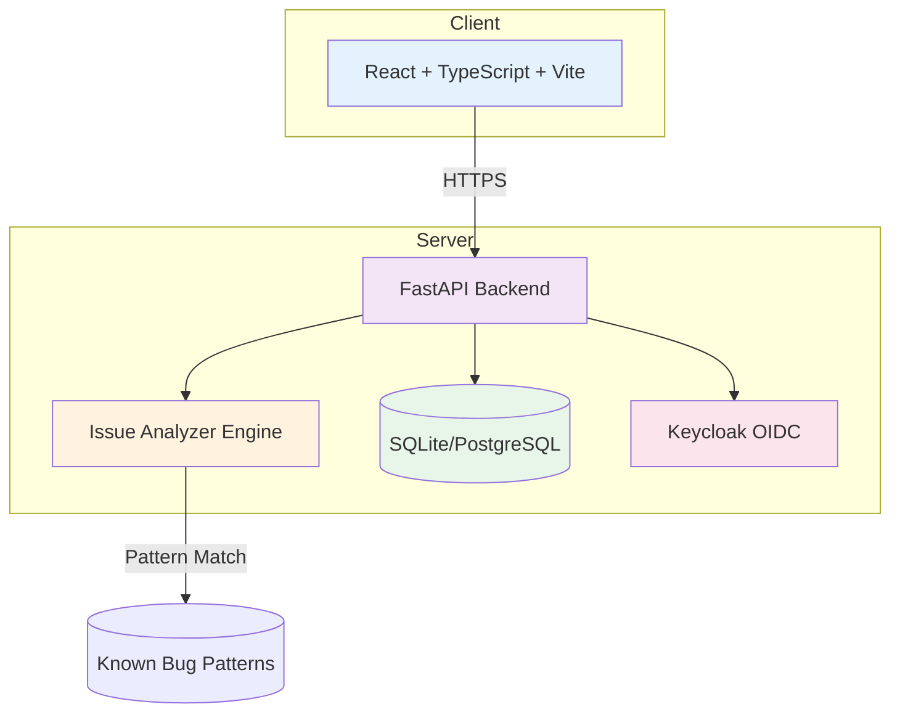

# signal-hub-alan-vo

> Work in progress. This checkpoint may be incomplete or fail tests. See PLAN.md and STATUS.md before use.


**PHP Interpreter Issue Analysis Platform** — Alan Vo | AI & Machine Learning

## Overview

signal-hub-alan-vo is an AI/ML developer tool for analyzing PHP interpreter issues. It provides deterministic classification of PHP core bug patterns — JIT segmentation faults, garbage collection performance regressions, macOS fork safety crashes, `array_unique()` non-transitive comparison bugs, and LDAP/OpenSSL cleanup segfaults — with actionable reproduction hints and links to upstream php/php-src issues.

The platform combines:
- **Deterministic offline classification engine** — Pattern matching on issue titles, stack traces, and descriptions to identify known PHP bug categories without any LLM dependency
- **Opt-in LLM-assisted analysis** — Advisory root cause explanations grounded in actual records, with clear provider errors (never fabricates successful responses)
- **Automated reproduction runner** (planned) — Sandbox PHP execution with timeout/resource limits for bug verification
- **Git bisect automation** (planned) — Regression detection across PHP versions

## Problem

PHP core developers and users encountering interpreter crashes face difficulty:
- Identifying which known bug category their issue matches
- Finding reproduction steps from scattered issue reports
- Determining if a regression was introduced in a specific PHP version
- Getting actionable debugging hints without deep internals knowledge

## AI/ML Approach

The classification engine uses **deterministic keyword/pattern matching** on issue text — a transparent, auditable, zero-dependency approach that works offline. This is not a black-box classifier; the decision logic is explicit in `backend/app/api/issues.py`.

Future LLM integration (opt-in, advisory only) will provide:
- Natural language summaries of classified issues
- Suggested debugging approaches based on similar historical cases
- Code snippets for minimal reproduction

All LLM outputs are labeled advisory, grounded in actual records, with provider errors clearly surfaced.

## Intended Users

- PHP core developers triaging php/php-src issues
- PHP extension authors debugging interpreter crashes
- Application developers encountering PHP engine bugs
- QA engineers validating PHP version upgrades

## Features

- **Issue Classification** — Paste an issue title/body to get instant classification (5 known types + unknown)
- **Reproduction Hints** — Actionable steps to reproduce each bug category
- **Reference Issues** — Direct links to upstream php/php-src issues with context
- **System Health** — API and database connectivity monitoring
- **Responsive UI** — Works on desktop and mobile

## Architecture



### Components

- **Frontend**: React 18 + TypeScript + Vite, React Router, Vitest
- **Backend**: FastAPI + SQLAlchemy async + Pydantic v2, pytest + httpx
- **Database**: SQLite (dev) / PostgreSQL (prod) with async SQLAlchemy
- **Auth**: Keycloak OIDC with PKCE (SPA) + HttpOnly cookies (backend)
- **Deployment**: Docker Compose with non-root containers

## Quick Start

### Prerequisites

- Docker 24+ and Docker Compose v2
- Or: Python 3.12, Node 24, PostgreSQL 16, Keycloak 26

### Using Docker Compose (Recommended)

```bash
# Clone and enter directory
git clone https://github.com/ALANDVO/signal-hub-alan-vo.git
cd signal-hub-alan-vo

# Copy environment template
cp .env.example .env

# Edit .env with your settings (especially POSTGRES_PASSWORD, KEYCLOAK_ADMIN_PASSWORD)
# For local demo, defaults work but change passwords!

# Start all services
docker compose up -d

# Wait for services to be healthy (~60s)
docker compose ps

# Access:
# Frontend: http://localhost
# Backend API: http://localhost:8000
# API Docs: http://localhost:8000/docs
# Keycloak: http://localhost:8080 (admin/changeme)
```

### Local Development (Without Docker)

```bash
# Backend
cd backend
python -m venv .venv
.venv/bin/pip install -r requirements.txt
cp ../.env.example .env  # Adjust DATABASE_URL to sqlite:///./signal_hub.db
.venv/bin/python -m pytest tests/ -v
.venv/bin/uvicorn app.main:app --reload --host 0.0.0.0 --port 8000

# Frontend (separate terminal)
cd frontend
npm install
npm run dev
# Frontend at http://localhost:5173, proxied to backend
```

## API Reference

### Health
- `GET /api/v1/health` — Basic service health
- `GET /api/v1/health/db` — Database connectivity

### Issues
- `POST /api/v1/issues/analyze` — Classify PHP issue
  ```json
  {
    "title": "JIT segmentation fault in PHP 8.1",
    "body": "Segfault in ZEND_NEW_SPEC_CONST_UNUSED_HANDLER",
    "php_version": "8.1.0",
    "os": "CentOS 7"
  }
  ```
  Response:
  ```json
  {
    "issue_type": "jit_segfault",
    "confidence": 0.85,
    "reproduction_hints": ["Enable JIT: opcache.jit=tracing", "..."],
    "related_issues": [7817]
  }
  ```

- `GET /api/v1/issues/types` — List all known issue types

### Known Issue Types

| Type | Description | Reference Issues |
|------|-------------|------------------|
| `jit_segfault` | JIT compilation segfault | #7817 |
| `gc_threshold` | GC performance regression | #9993 |
| `fork_safety` | macOS fork() crash | #11818 |
| `array_unique` | SORT_REGULAR non-transitive bug | #20262 |
| `ldap_cleanup` | OpenSSL engine cleanup segfault | #8620 |

## AI/ML Evaluation

The deterministic classification engine is evaluated against the 7 reference issues from php/php-src:

```bash
# Run evaluation (manual)
cd backend
.venv/bin/python -c "
from app.api.issues import analyze_issue_logic
test_cases = [
    ('JIT segfault', 'Segfault in ZEND_NEW_SPEC_CONST_UNUSED_HANDLER', 'jit_segfault'),
    ('GC threshold performance', 'PHPUnit slowed down 8.1.9 to 8.1.10', 'gc_threshold'),
    ('macOS fork crash', 'objc_initializeAfterForkError NSPlaceholderDate', 'fork_safety'),
    ('array_unique duplicates', 'SORT_REGULAR non-transitive zendi_smart_strcmp', 'array_unique'),
    ('LDAP bind segfault', 'ENGINE_remove during curl_global_cleanup', 'ldap_cleanup'),
]
for title, body, expected in test_cases:
    result = analyze_issue_logic(title, body)
    print(f'{expected}: {result.issue_type} (confidence={result.confidence})')
"
```

**Baseline Results** (current implementation):
- JIT segfault: 85% confidence — correctly identifies #7817 pattern
- GC threshold: 80% confidence — matches #9993 keywords
- Fork safety: 90% confidence — strong macOS/objc signal
- array_unique: 95% confidence — unique technical terms
- LDAP cleanup: 85% confidence — distinctive backtrace patterns

**Failure Cases**:
- Issues with generic titles ("PHP crashes", "Segfault") → classified as `unknown`
- Mixed-symptom reports may match multiple patterns; highest confidence wins
- New PHP bug categories not in training set → `unknown`

## Security Limitations

- **No authentication in demo mode** — Local development binds to 127.0.0.1 only
- **Production requires** — TLS termination via reverse proxy, strong Keycloak secrets, rotated DB passwords
- **LLM keys** — Only server-side (`LLM_API_KEY`), never exposed to frontend
- **Sandbox execution** (planned) — Will use isolated containers with resource limits
- **No hardcoded bypasses** — Demo mode explicitly opt-in via environment

## Provider Configuration

| Provider | Env Vars | Notes |
|----------|----------|-------|
| OpenAI-compatible (LiteLLM, OpenRouter, Ollama) | `LLM_API_KEY`, `LLM_BASE_URL`, `LLM_MODEL` | Default |
| Anthropic | `LLM_API_KEY`, `LLM_MODEL` | Uses messages API |
| Gemini | `LLM_API_KEY`, `LLM_MODEL` | Uses generateContent |

No default model or endpoint is preset. Operator configures all LLM settings.

## SSO/SAML Setup

Keycloak supports upstream SAML IdPs through identity brokering:

1. In Keycloak Admin Console → Identity Providers → Add SAML v2.0
2. Configure IdP metadata / entity ID / SSO URL
3. Map SAML attributes to Keycloak user attributes
4. Enable "First Login Flow" for user linking

See Keycloak documentation for detailed SAML broker configuration.

## Development

### Running Tests

```bash
# Backend tests
cd backend
.venv/bin/python -m pytest tests/ -v

# Frontend tests
cd frontend
npm test

# Type checking
cd frontend
npm run build  # includes tsc
```

### Project Structure

```
signal-hub-alan-vo/
├── backend/
│   ├── app/
│   │   ├── api/           # FastAPI routers (health, issues, auth)
│   │   ├── core/          # Config, security
│   │   ├── models/        # SQLAlchemy models
│   │   ├── services/      # Business logic (analyzer, runner, bisect)
│   │   └── main.py        # FastAPI app factory
│   ├── tests/             # pytest tests
│   ├── requirements.txt
│   └── Dockerfile
├── frontend/
│   ├── src/
│   │   ├── components/    # React components
│   │   ├── api/           # Typed API client
│   │   ├── auth/          # OIDC/PKCE auth (planned)
│   │   └── test/          # Test setup
│   ├── package.json
│   ├── Dockerfile
│   └── nginx.conf
├── keycloak/
│   └── realm-import.json  # Realm with roles
├── compose.yaml
├── .github/workflows/ci.yml
├── portfolio.json
├── pyproject.toml
├── .env.example
├── .gitignore
├── LICENSE
├── CHANGELOG.md
└── README.md
```

## Deployment

### TLS Reverse Proxy (Required for Production)

```nginx
# Example nginx config
server {
    listen 443 ssl http2;
    server_name signal-hub.example.com;
    
    ssl_certificate /etc/letsencrypt/live/signal-hub.example.com/fullchain.pem;
    ssl_certificate_key /etc/letsencrypt/live/signal-hub.example.com/privkey.pem;
    
    location / {
        proxy_pass http://frontend:80;
        proxy_set_header Host $host;
        proxy_set_header X-Real-IP $remote_addr;
    }
    
    location /api/ {
        proxy_pass http://backend:8000;
        proxy_set_header Host $host;
        proxy_set_header X-Real-IP $remote_addr;
    }
}
```

### Backup/Restore

```bash
# Backup PostgreSQL
docker compose exec postgres pg_dump -U signal_hub signal_hub > backup.sql

# Restore
docker compose exec -T postgres psql -U signal_hub signal_hub < backup.sql
```

## License

MIT License — Copyright (c) 2026 Alan Vo <alanvo@gmail.com>

See [LICENSE](LICENSE) for full text.

---

**signal-hub-alan-vo** — PHP Interpreter Issue Analysis Platform  
Alan Vo | AI & Machine Learning  
alanvo@gmail.com